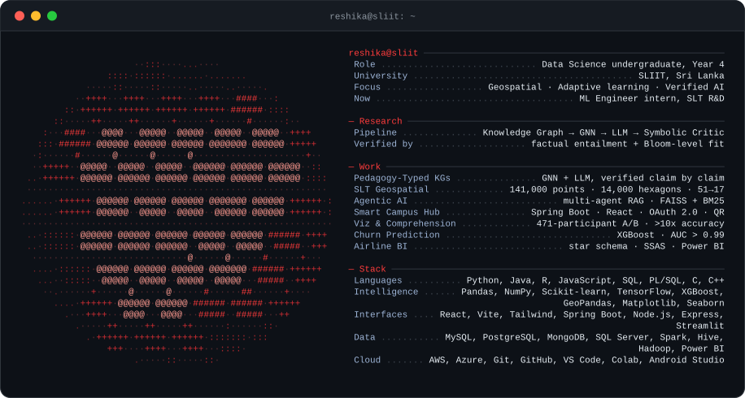

Plain text version

 

**Reshika Amarasinghe.** Fourth-year Data Science undergraduate at SLIIT, Sri Lanka. ML Engineer intern at SLT R&D. Focus: geospatial analytics, adaptive learning, verified AI.

**Research.** A neuro-symbolic middleware for adaptive learning: Knowledge Graph → GNN learner model → LLM learning path → Symbolic Critic, with every explanation verified for factual entailment and Bloom-level fit.

**Work**
- **Pedagogy-Typed Knowledge Graphs**: GNN learner modelling, with LLM explanations verified claim by claim.
- **SLT Geospatial Pipeline**: 141,000 fibre points across ~14,000 hexagons; 51 variables engineered into 17 features to rank the top 100 expansion sites.
- **Agentic AI System**: two collaborating agents, a decision gate, RAG retrieval with FAISS and BM25.
- **Smart Campus Operations Hub**: Spring Boot and React, OAuth 2.0, JWT, QR check-in, SLA-tracked ticketing.
- **Visualization & Comprehension Study**: 471-participant A/B study, comprehension accuracy up more than 10x.
- **Churn Prediction**: XGBoost, AUC above 0.99, Streamlit app.
- **Airline BI & Data Warehouse**: star schema, SCD Type 2, SSAS cubes, Power BI.

**Stack.** Python, Java, R, JavaScript, SQL, PL/SQL, C, C++ · Pandas, NumPy, Scikit-learn, TensorFlow, XGBoost, GeoPandas, Matplotlib, Seaborn · React, Vite, Tailwind, Spring Boot, Node.js, Express, Streamlit · MySQL, PostgreSQL, MongoDB, SQL Server, Spark, Hive, Hadoop, Power BI · AWS, Azure, Git, GitHub, VS Code, Colab, Android Studio

