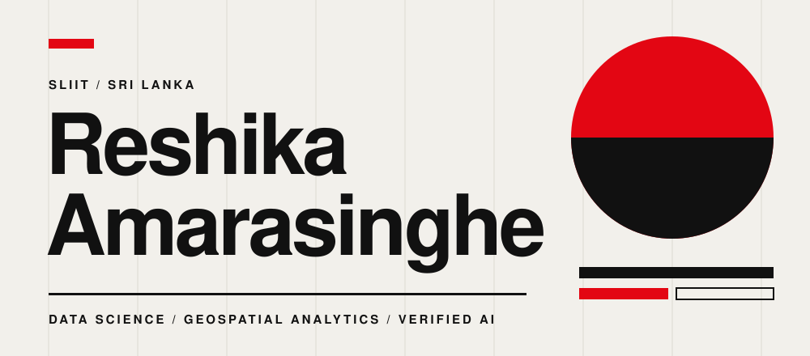
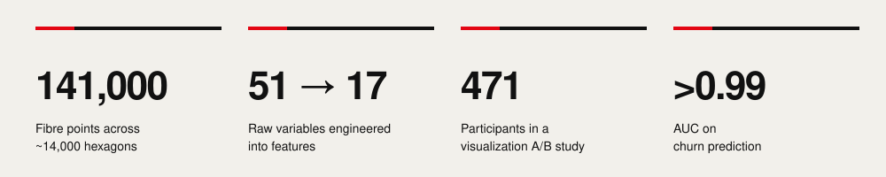
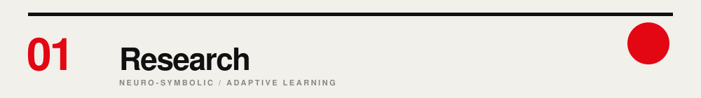
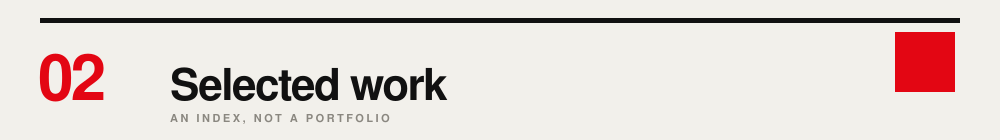
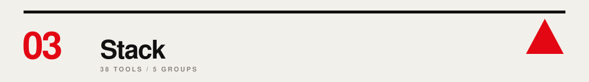
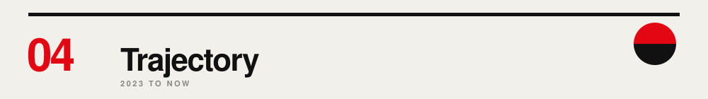

I build systems that survive contact with reality. Fourth-year Data Science undergraduate at SLIIT, working on problems shaped by real operational needs.

 

**Neuro-symbolic middleware for adaptive learning.** An LLM proposes a learning path. A symbolic critic checks it against a typed knowledge graph, claim by claim, and rejects anything that skips a prerequisite.

**1**&emsp;**Knowledge Graph**: concepts and pedagogy, typed. 
**2**&emsp;**GNN Learner Model**: mastery and uncertainty for each learner. 
**3**&emsp;**LLM Learning Path**: generated, then challenged. 
**4**&emsp;**Symbolic Critic**: verifies every explanation twice, for factual entailment against the graph and for fit to the learner's Bloom level. Rejects, then regenerates.

 

**01**&emsp;**Pedagogy-Typed Knowledge Graphs** 
Final-year research. GNN learner modelling, with LLM explanations verified claim by claim against a knowledge graph. 
GNN / KNOWLEDGE GRAPH / LLM

**02**&emsp;**SLT Geospatial Pipeline** 
141,000 fibre points across ~14,000 hexagons. 51 raw variables engineered into 17 features to rank the top 100 expansion sites. 
GEOPANDAS / ML

**03**&emsp;**Agentic AI System** 
Two collaborating agents, a decision gate and traceable retrieval with FAISS and BM25. 
RAG / REACT / MONGODB

**04**&emsp;**Smart Campus Operations Hub** 
Full-stack platform with OAuth 2.0, JWT, QR check-in and SLA-tracked incident ticketing. 
SPRING BOOT / REACT

**05**&emsp;**Visualization & Comprehension Study** 
471-participant A/B study. Clear charts lifted comprehension accuracy by more than 10x. 
R / BAYESIAN

**06**&emsp;**Churn Prediction** 
AUC above 0.99, shipped as an interpretable app. 
XGBOOST / STREAMLIT

**07**&emsp;**Airline BI & Data Warehouse** 
Star schema, SCD Type 2, SSAS cubes and drill-through dashboards. 
SQL SERVER / POWER BI

 

LANGUAGES 
 
SQL / PL/SQL

INTELLIGENCE 
 
Pandas / NumPy / XGBoost / GeoPandas / Matplotlib / Seaborn

INTERFACES 
 
Streamlit

DATA 
 
SQL Server / Spark / Hive / Hadoop / Power BI

CLOUD & CRAFT 
 
Colab

 

**2023**&emsp;SLIIT. BSc Data Science begins. 
**2025**&emsp;Agentic AI. Multi-agent RAG system. 
**Dec 2025**&emsp;SLT R&D. ML Engineer intern. 
**2026**&emsp;Research. GNNs and knowledge graphs. 
**Now**&emsp;Year 4. Building what's next.
