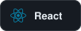

I build systems that survive contact with reality. 
Fourth-year Data Science undergraduate at SLIIT, Sri Lanka.

 
 
 
0.99 AUC ON CHURN PREDICTION"/> 
 

**Neuro-symbolic middleware for adaptive learning.** 
An LLM proposes a learning path. A symbolic critic checks it against a typed knowledge graph, 
claim by claim, and rejects anything that skips a prerequisite.

 
Concepts and pedagogy, typed.

 
Mastery and uncertainty for each learner.

 
Generated, then challenged.

 
Verifies every explanation twice, for factual entailment against the graph and fit to the learner's Bloom level. Rejects, then regenerates.

 

 
Final-year research. GNN learner modelling, with LLM explanations verified claim by claim against a knowledge graph. 
  

 
141,000 fibre points across ~14,000 hexagons. 51 raw variables engineered into 17 features to rank the top 100 expansion sites. 
 

 
Two collaborating agents, a decision gate and traceable retrieval with FAISS and BM25. 
  

 
Full-stack platform with OAuth 2.0, JWT, QR check-in and SLA-tracked incident ticketing. 
 

 
471-participant A/B study. Clear charts lifted comprehension accuracy by more than 10x. 
 

 
AUC above 0.99, shipped as an interpretable app. 
 

 
Star schema, SCD Type 2, SSAS cubes and drill-through dashboards. 
 

 

 
       

 
       

 
      

 
       

 
      

 

&ensp;BSc Data Science begins 
&ensp;Multi-agent RAG system 
&ensp;ML Engineer intern 
&ensp;GNNs and knowledge graphs 
&ensp;Building what's next 

 

